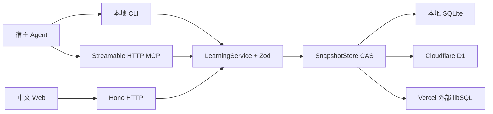

# 架构与数据

## 一条业务路径

`src/contracts` 以 Zod 定义输入、实体与机器错误；`src/core` 负责包引用校验、选题、快照、作答状态、评分、进度和迁移。CLI、HTTP Web 与 MCP 都调用 `LearningService.execute(operation, input)`，不另写阅卷规则。

`src/cli` 处理参数、profile 和受限的包读取；`src/server` 负责认证、同源保护、RPC 和静态文件；`src/mcp` 负责官方 SDK 工具发现与调用；`web` 只呈现学习与提交数据。核心没有 Node 文件系统依赖。所有文本都作为不可信内容呈现，材料中的文字不会升级为平台指令。

## 有界聚合与原子性

v0.1 面向个人小型文本学习实例，SQL 中以一个带 revision 的聚合状态保存各实体映射。状态上限 **1,500,000 UTF-8 字节**，超限返回 `CAPACITY_EXCEEDED`，不会丢弃历史。材料正文内联于包，课程持有题目和材料快照，因此无需 R2 或独立附件服务。当前不支持二进制资产；重度使用者应在容量接近上限时导出备份，并等待后续分表版本。

一次业务变更先读取 revision 与状态，在副本中校验和计算，再执行单条条件更新 `UPDATE ... WHERE revision = ?`。写入冲突会有限重读重算；过期的用户 `expected_version` 会明确拒绝。SQLite、D1、libSQL 都真实执行该原子 SQL，不把 D1 不支持的交互式事务包装成通用事务。首次建表与 schema version 见 `migrations`；主键定位唯一实例行，索引由主键提供。各实体的列表和关联检索在有界快照内完成，未伪称具有大规模数据库检索性能。

## 实体与历史

`PackVersion` 保存准确版本、内容、checksum、安装来源与实际解析的 GitHub commit；`Goal` 固定关联包版本。包升级安装为新版本，历史版本保留，已有目标不会静默切到新内容。

`Lesson` 保存讲解、情境摘要、topic、kind、题目/材料快照与发布状态。`Attempt` 保存逐题答案、版本与 `in_progress → submitted → reviewed` 状态；同课程可以用新幂等键重做。`Review` 保存逐题成绩和反馈，修改需版本与理由，并保留修订记录。`Evidence` 将每道题的得分与目标、知识点、评价版本关联；`Progress` 区分曝光与答题证明，并保存复习时间。所有 ID 稳定，时间存 ISO UTC，Web 按浏览器本地时区呈现。

重复发布、相同答案提交和相同阅卷幂等键不会重复计算进度；同一幂等键配不同业务内容会拒绝。新评价修订会更新对应证据，避免把同一答题重复计入。

复习规则以本轮同一知识点的得分率决定：低于 60% 在提交后 1 天复习，60%～不足 85% 在 3 天后复习，85% 及以上在 7 天后复习。累计得分率达到 85% 且至少有 2 道题证据时标记 `demonstrated`；60% 及以上为 `practicing`，其他已答题为 `learning`，没有评价证据为 `unknown`。`correct` 是满分题数，`earned/possible` 反映部分分；发布课程只增加 exposures。选题优先待处理事项、到期与薄弱知识，并递归检查未证明掌握的前置主题。该规则只表达已有证据，不推断考试通过率。

## 命令与工具映射

| CLI | MCP / 核心操作 |
| --- | --- |
| `status` / `profile` | `get_status`；profile 是客户端配置 |
| `pack install/list/show/validate` | `install_pack/list_packs/get_pack/validate_pack` |
| `material search` | `search_materials` |
| `goal create/list/show/update` | `create_goal/list_goals/get_goal/update_goal` |
| `progress` / `review due` | `get_progress/get_due_reviews` |
| `plan next` | `plan_next_session` |
| `lesson create/publish/show` | `create_lesson/publish_lesson/get_lesson` |
| `attempt start/draft/submit/pending/show` | 对应 attempt 核心操作 |
| `review submit` | `submit_review` |
| `export` / `import` | `export_data/validate_import/import_data` |

CLI 的 `--json` 输出封套为 `{ok:true,data}` 或 `{ok:false,error:{code,message,details?}}`。日志写 stderr。HTTP 与 MCP 复用相同错误语义；MCP 另外遵守协议的 tool result 错误标志。题目答案键、rubric 和解析由教师读取；学习端未完成评价前只得到作答所需数据。

## 运行时差异

本地 CLI 直接使用 SQLite，即使 Web 停止也可备课与阅卷。Web 必须显式启动。Workers 通过 D1 binding 读写，Vercel 使用外部 libSQL；Vercel 函数本地文件系统不作为数据源。Web 构建为同一份静态文件，认证和公开 base URL 由部署配置传入。

远程 Web 使用 HttpOnly 会话 cookie；教师 MCP/管理 RPC 使用 Bearer 凭证。凭证只从环境读取，导出不包含这些部署配置。单用户 token 机制不代替团队或 OAuth 身份系统。
